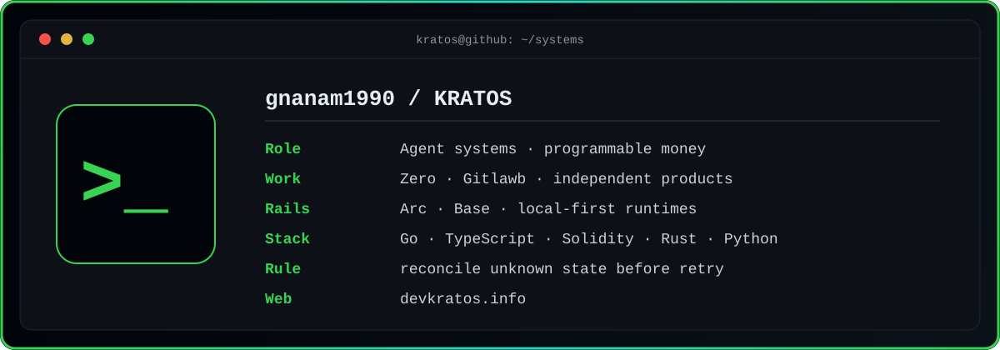

# KRATOS · Gnanam Jaganathan

<div align="center">



<br/>

<a href="https://devkratos.info"></a>
<a href="https://github.com/gnanam1990"></a>
<a href="https://x.com/pindropsx"></a>

</div>


## `$ whoami`

I build agent systems that can act without asking people to trust a black box: scoped authority, explicit failure states, verifiable settlement and recovery before retry.

My work sits across **local-first AI agents**, **developer infrastructure** and **programmable money on Arc and Base**. This profile focuses on accepted open-source contributions; my evidence-labelled product portfolio lives separately at [devkratos.info](https://devkratos.info).

- **Core developer:** [Zero](https://github.com/Twigpine/zero) and [Zero App](https://github.com/Twigpine/zero-app)
- **Contributor:** [OpenClaude](https://github.com/Twigpine/openclaude), [OpenClaude Skills](https://github.com/Twigpine/openclaude-skills), [Open WebUI](https://github.com/open-webui/open-webui), [Hermes Agent](https://github.com/NousResearch/hermes-agent) and [OpenClaw](https://github.com/openclaw/openclaw)
- **Award:** Winner, Ignyte Stablecoins Commerce Stack Challenge (Circle), for [Snapfall](https://github.com/gnanam1990/snapfall)
- **Portfolio:** [devkratos.info](https://devkratos.info)
- **Primary stack:** Go · TypeScript · Solidity · Rust · Python · React


## `$ git shortlog --accepted`

Public merge history verified **17 November 2026**. Counts are a dated snapshot; each link opens the accepted pull requests rather than a self-reported total.

- **[Zero](https://github.com/Twigpine/zero/pulls?q=is%3Apr+author%3Agnanam1990+is%3Amerged) — 197 merged PRs.** ACP/MCP interoperability, swarm handoff, session and tool lifecycles, locking, providers, privacy, sandboxing and adversarial fixes across the Go runtime.
- **[Zero App](https://github.com/Twigpine/zero-app/pulls?q=is%3Apr+author%3Agnanam1990+is%3Amerged) — 150 merged PRs.** Provider-neutral agent chat plus permissioned computer control across macOS, Windows and Linux, with application identity, scoped grants and recovery after denied or failed actions.
- **[OpenClaude](https://github.com/Twigpine/openclaude/pulls?q=is%3Apr+author%3Agnanam1990+is%3Amerged) + [OpenClaude Skills](https://github.com/Twigpine/openclaude-skills/pulls?q=is%3Apr+author%3Agnanam1990+is%3Amerged) — 87 merged PRs.** OAuth and provider reliability, runtime failure handling, input/tool ergonomics and reusable production workflows.
- **[Open WebUI](https://github.com/open-webui/open-webui/pulls?q=is%3Apr+author%3Agnanam1990+is%3Amerged) — Tamil localisation accepted.** Two merged contributions added and completed the `ta-IN` interface path.
- **[Hermes Agent](https://github.com/NousResearch/hermes-agent/pulls?q=is%3Apr+author%3Agnanam1990+is%3Amerged), [OpenClaw](https://github.com/openclaw/openclaw/pulls?q=is%3Apr+author%3Agnanam1990+is%3Amerged) and [Brian](https://github.com/Twigpine/brian/pulls?q=is%3Apr+author%3Agnanam1990+is%3Amerged).** Accepted work covers the Memory Ferry catalog integration, recovery-safe diagnostics and a golden-parity EWMAC strategy port.

> These are collaborative repositories. The wording above describes my accepted contribution lane, not sole authorship.


## `$ git activity --since 2026-01-01`

<div align="center">


<br/>

| verified 2026 snapshot | count |
| :--- | ---: |
| `all_time_github_contributions` | **11.66k+** |
| `2026_commits` | **2,136** |
| `2026_pull_requests` | **579** |
| `2026_total_contributions` | **3,342** |

<picture>
  <source media="(prefers-color-scheme: dark)" srcset="https://raw.githubusercontent.com/gnanam1990/gnanam1990/output/github-contribution-grid-snake-dark.svg" />
  <source media="(prefers-color-scheme: light)" srcset="https://raw.githubusercontent.com/gnanam1990/gnanam1990/output/github-contribution-grid-snake.svg" />
  
</picture>

<sub>Snapshot verified 17 November 2026 through GitHub's contributions data. The 11.66k figure is all-time GitHub contributions—not commit count. The chart and calendar show date-wise activity and update independently; private contribution details may remain hidden by GitHub.</sub>

</div>


## `$ cat engineering-principles.md`

```text
model proposes       policy decides
submitted != settled reconcile unknown state before retry
live != testnet       label proof honestly
recovery is a flow    not an afterthought
```

I use coding agents aggressively, but never as evidence. A product is complete only when the real path persists through restart, failure, verification and recovery.


## `$ stack --current`

```text
agents      Go · TypeScript · Python · local and hosted model runtimes
onchain     Solidity · Foundry · Arc · Base · Circle USDC
products    React · Next.js · TanStack · PostgreSQL
systems     Linux · Docker · GitHub Actions · Railway · Vercel
```

<div align="center">

<sub>Build the real path. Label the proof. Reconcile before retry.</sub>

</div>
